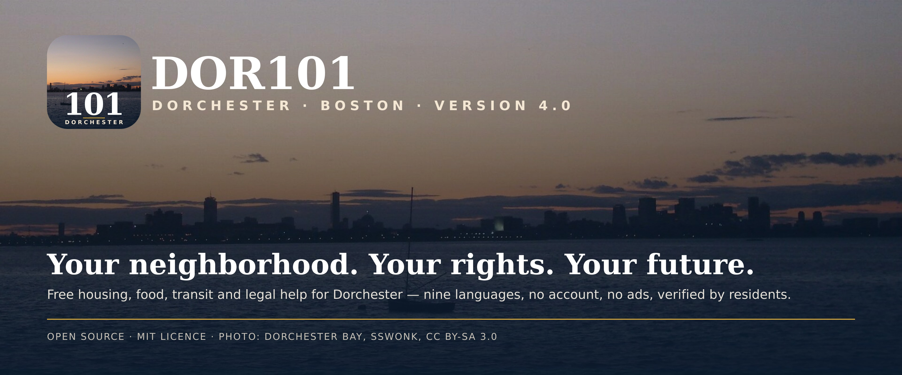
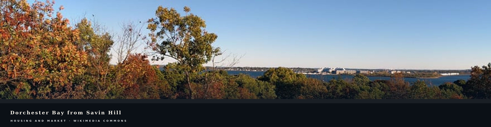

<p align="center">
  
</p>

<h1 align="center">DOR101 — Dorchester 101</h1>

<p align="center"><strong>Your neighborhood. Your rights. Your future.</strong></p>

<p align="center">
  <a href="https://github.com/Nikoxkx/Dorchester-101/releases/latest"></a>
  <a href="LICENSE"></a>
  
  
  
</p>

DOR101 is a free, open-source guide to help in **Dorchester, Boston**: housing you can afford, food when money runs short, the bus or train that gets you there, and the legal rights that protect you as a tenant. Every number on the site is traced to the public authority that published it, every listing shows the date a resident last checked it, and the whole thing works in nine languages with **no account, no ads and no data collection**.

It ships as a website (installable as a PWA and usable offline) and as a Windows desktop application.

---

## Table of contents

1. [What's new in 4.0](#whats-new-in-40)
2. [Download & install](#download--install)
3. [Features](#features)
4. [Languages & accessibility](#languages--accessibility)
5. [Data sources](#data-sources)
6. [Technology](#technology)
7. [Architecture](#architecture)
8. [For developers](#for-developers)
9. [Configuration](#configuration)
10. [Testing & quality](#testing--quality)
11. [Privacy & security](#privacy--security)
12. [Contributing](#contributing)
13. [Image credits & licence](#image-credits--licence)
14. [Who built this](#who-built-this)
15. [How AI was used](#how-ai-was-used)

---

## What's new in 4.0

### Latest fix pass (4.3 — on top of 4.2/4.1)

| Area | Change |
|------|--------|
| **Every user-visible string now goes through the dictionary** | The last screens that still shipped English in their JSX — the tools page (rent/AMI calculators, document checklist), the housing primer, the extra calculators, the field notes, source marks, QR poster, badge wall, weather shared pieces, the per-page source notes — were converted to keys, then a new guard (`src/__tests__/i18n-hardcoded.test.ts`) was added: it parses `src/app` and `src/components` with the TypeScript compiler API and fails the build when JSX text, a visible attribute (`title`, `alt`, `aria-label`, `placeholder`, …) or a conditional-expression literal still holds English prose. A second test keeps a `PENDING` list honest, so the remaining backlog can only shrink. 234 new keys × 9 languages; map attribution and brand strings stay verbatim by design. |
| **Apple-style weather + what-to-wear pop-up** | The weather surfaces were redrawn the way a phone weather app draws them, entirely from the live NWS payload (`src/components/weather/WeatherVisuals.tsx`): a sky-gradient hero chosen by the live condition, glass hour cards, a smooth 24-hour temperature curve, precipitation bars, 7-day temperature-range bars with a "you are here" dot, a sun-path arc and a wind compass. A small **What to wear today** card now lives in the corner of every page (`WearTodayToast`): it re-derives its tip from the live forecast every minute, dismissing it remembers *that advice* (Boston date + tip + 5 °F band) so tomorrow's weather — or a real temperature swing — brings it back, and whenever the tip implies warm gear it links straight to the free-coats list. |
| **Screenshot-led link previews** | One lightweight 1200×630 JPEG frames an actual browser screenshot of the homepage. Public pages share the same card with matching, section-specific Open Graph and X/Twitter copy. A content-hashed static URL avoids image-generation cold starts and conflicting file-based metadata. Regenerate with `npm run refresh:social`; see [Social previews](docs/SOCIAL-PREVIEWS.md) for capture, deployment and cache refresh instructions. Platform display and cropping vary. |
| **Map: menu overlap + vanishing satellite fixed** | Leaflet's panes carry z-indexes up to ~1000 and, without a stacking context of their own, painted over the fixed sidebar — opening the menu on the map page put the map *over* the site. The map container is now `isolation: isolate` (rail 1200 / scrim 1150), so every Leaflet layer stays inside the map box. The satellite basemap could also disappear permanently: the resilient tile layer remembered falling back to a later provider across style switches. It is keyed by style now, so Satellite always starts again from real Esri imagery. |
| **Live buses & trains on the map** | The map now draws the actual vehicles from the MBTA's public `VehiclePositions.pb` feed (`/api/mbta?type=vehicles`, 15 s heartbeat, stale GPS reports dropped): route-coloured pills with direction-of-travel arrows, for buses and trains alike. Tapping one opens its panel — fleet number, next stop and whether it is stopped there, speed, on-board crowding when reported, and the report's age — beside a clickable stops list for the focused route with the vehicle's next stop lit. |
| **Map & transit audit, help band reskinned, NowBar retired (4.9)** | Every map component was audited end to end. The place/stop sheet — photo, hours, get-there directions (Google/Apple Maps with a real origin), live departures, fares — carried hardcoded English; it is now fully translated like the rest of the site (36 new keys × 9 languages). Map markers carry real accessible names (Leaflet `title`, since `alt` alone names nothing on a div-icon), the sheets return focus to whatever opened them, close targets grew to 36 px, the place-layer selector reports its state truthfully, alert expiry reads "Until …" instead of "Last …", first/last-train labels no longer borrow a parameterized string, and the dock gained a **Places on the map** list so every pin is reachable by keyboard, not only by tapping the canvas. The "Need food or housing help today?" band dropped its one-off accent slab and is now an ordinary site card with transparent-background icon and call buttons like the rest of the site (4.9.1 removed its last gradient fills and the now-unused aurora-wash CSS). The "Dorchester right now" strip was removed — component, homepage slot and Settings row deleted, with a settings migration (v5) stripping the retired slot from stored layouts. |
| **Weather is opt-in, sections are yours (4.8)** | Weather now starts **off** and is turned on in **Settings → Weather**: one master switch gates the homepage weather panel, the `/weather` page and every menu/search link to it, the what-to-wear pop-up and the status-bar weather chip — while National Weather Service **storm warnings always show**, switch or no switch. Existing visitors who had arranged their homepage keep weather on (one-time migration, unit-tested in `weatherSettings.test.ts`); everyone else gets the new default. The `/settings` deep link `/settings#weather` and the weather page itself both offer the switch, so nobody is stranded. Section management also grew: beside the homepage's show/hide + move up/down list (Settings → Homepage, all 10 sections), the `/weather` page's own blocks — current conditions & sun/moon, what-to-wear spotlight, full tips list, hour-by-hour, 7-day, method note — are show/hideable and reorderable in Settings → Weather, with active alerts pinned first because safety is not furniture. |
| **Zero-touch updates (4.7)** | Deploying a new version no longer asks anything of residents. The web/installed app checks hourly, on foreground and on reconnect; a found update asks while the page is on screen (Reload is the resident's tap — nothing ever reloads under a half-filled form), and **applies itself silently the moment the app is backgrounded**, so even an app that is never swiped closed ends up current and a dismissed prompt defers instead of stranding the update. The policy is one pure, tested function (`src/lib/updatePolicy.ts`); registration and the whole update lifecycle now have a single owner (`ServiceWorkerRegistration` — a duplicate registration in the install prompt was removed). The Windows app does the same via `electron-updater` (background download, install on quit, checks 20 s after launch and every 6 h) — it activates as soon as the first GitHub Release publishes `latest.yml` (see *Owner checklist*). The homepage weather panel also regained its full 4.4 composition (curve, precipitation, 7-day and the what-to-wear spotlight as glass modules) and the NowBar its diagonal sheen — all still in the site's palette/aurora skin. |
| **Weather in the site's own skin (4.6)** | The NowBar and the weather surfaces stopped carrying private color stories. The NowBar (retired in 4.9) became an ordinary site card — a labelled `section` (it was a `div`, which the homepage glass/aurora card recipes silently skipped) with the standard card tokens, the `dor101-glass` surface blur, and the site's **shared aurora wash** (`.dor101-aurora-wash`: the backdrop's own two-radial accent glow recipe, drifting only while the aurora surface is active) — so palette, surface and homepage card style dress it exactly like every other section. The weather sky derives from the resident's palette too: `.wx-sky-host` captures the active accents, a soft-light aurora wash (`.wx-sky-aurora`) tints the condition gradient with them, the glass modules wear the homepage aurora-card recipe, the in-sky accent is the site accent lightened for sky contrast, and every button on the sky (full-forecast, back-to-now, free-coats CTA, strip arrows, refresh, unit toggle) is the site's primary gradient or token glass. Pick Violet + aurora and the whole weather section — sky included — turns violet aurora with the rest of the page. |
| **A calmer homepage, a richer sky (4.5)** | The live "Dorchester now" strip moved from the top of the homepage to its foot (new default order + a persist migration for un-customized layouts; Settings can still put it anywhere), and the homepage weather panel slimmed down to a glance — hero, hour-by-hour strip, 7-day list, one what-to-wear line — so `/weather` is the destination that pops. The strip's scroll arrows and "back to now" pill, which used to float *over* the first and last hour chips, now live in a toolbar under the strip in normal flow (dimmed at the ends, RTL-aware): no control anywhere in the weather UI overlays a number anymore. The sky itself grew up: the moon is drawn at **tonight's real phase** (computed astronomy in `src/lib/moon.ts`, tested against eclipse dates), the sun gained a slow ray shimmer, clouds are multi-blob, a meteor streaks clear nights now and then, and condition changes crossfade. `/weather` adds a full-width **Sun & moon** module — gradient sun arc that draws itself in with a rayed sun by day and the phase-true moon riding the same arc by night, illumination, cycle day, next full/new moon, and a seven-night moon preview — plus the what-to-wear spotlight moved here from the homepage, ahead of the full tips list. |
| **A living sky (4.4)** | The homepage weather panel and the `/weather` hero are now one animated sky per live condition (`SkyBackdrop` in `WeatherVisuals.tsx`, pure layer logic pinned by `skyLayers.test.ts`): a breathing sun or a glowing moon, twinkling stars, drifting clouds, rain that falls the full height of the panel, swaying snow, low fog bands and a rare, distant lightning flicker — all seeded so every visitor sees the same sky, and all switched off under reduced motion. Every module (temperature curve, precipitation, 7-day list, what-to-wear, the detail tiles) floats on that sky in frosted glass — `.wx-module` over `.wx-glass-scope`, which re-points the ink tokens at white so every chart reads on glass. The big temperature counts up to its value (`useAnimatedNumber`), the curve draws itself in, precipitation bars grow in a stagger, hero condition icons idle in place (a slow-spinning sun, bobbing rain), and modules rise into view as you scroll — the dense NWS text (48 hourly rows, alert prose) stays on solid cards where it is easiest to read. |
| **A homepage you arrange (4.3)** | Settings → Homepage lists every homepage section with show/hide switches and move up/down controls, plus a card style (Match site surface, Solid, Glass, Tinted, Aurora) scoped to the homepage alone — the five surface recipes as CSS variables under `.dor101-home[data-cards]`. The storm-warning banner is deliberately not removable; it always rides just ahead of the weather. The live strip at the top of the homepage takes the interface's own accent colors, so recoloring the site recolors the strip in the same instant. The what-to-wear spotlight gained a rotating **"Did you know?"** strip: facts computed from the same live payload (tonight's sunset, the week's warmest afternoon and coldest night, the wettest hour, today's temperature swing, the wind right now) crossfading with two pieces of Dorchester history. |
| **Weather graphs you can scrub (4.3)** | The 24-hour temperature curve is now interactive the way a phone weather app is: hovering or gliding a pen sweeps a dashed crosshair with a floating readout (hour, temperature, condition, rain chance), a tap/click pins it, arrow keys walk it hour by hour (`role="slider"` with `aria-valuetext`), and touch keeps its horizontal scroll instead of fighting the scrub. Precipitation bars highlight on hover/tap/focus with a readout line (time · % · temperature · condition). |
| **Updates that install themselves (4.3)** | Nobody re-downloads anything. On the web/installed PWA the service worker now re-checks for a newer build hourly, on foreground, and on reconnect (previously only on navigation) and still asks before reloading; Settings → Data has a manual **Check for updates**. The Windows app uses `electron-updater` against GitHub Releases: checks after launch and every six hours, downloads in the background, and offers "Restart now / Later" (Later applies on quit) — portable builds and offline starts are untouched. The release workflow now publishes `latest.yml` + blockmaps beside the exes, which is the feed the updater reads. |
| **Privacy asked plainly (4.3)** | A one-time notice (not a cookie wall — the site sets no tracking cookies and runs no ads) explains in one paragraph that settings live in on-device local storage, that nothing is sold or shared, and that location/notifications are only ever requested behind their own labelled buttons, with links to Settings → Permissions and the Privacy page. The PWA install banner now speaks iPhone/iPad too (Share → Add to Home Screen steps, since iOS has no install prompt event) and is localized in all nine languages. |
| **Map: the clicked bus always draws its line (4.3)** | If the shapes feed has no geometry for a tapped vehicle's route (bus geometry goes missing most), the map threads a line through the route's own stops in order — labelled timetable geometry — so "tap a bus, see its whole route and stops" holds even on a bad feed day; stop markers also rise above the dimmed routes while a vehicle is emphasized. |
| **What to wear, one moment at a time (4.2)** | The homepage section used to stack four tips (Today… Tonight… Tonight…). It is now a single sky-gradient **spotlight**: `dayPhase()` picks the reader's part of the day from real Boston sunrise/sunset (wall-clock fallback) and `pickSpotlightTip()` shows exactly one tip for that moment at the current feels-like temperature — storm and freezing-rain safety always override. A morning/afternoon/evening/night rail shows where the advice sits in the day, arrows peek at the day's other moments one by one, and the corner pop-up, the hero line and the spotlight all speak from the same picker. The full list still lives on `/weather`. |
| **Weather visuals are never squished (4.2)** | The 24-hour temperature curve was a 720-wide SVG stretched into any box (`preserveAspectRatio="none"`), which visibly compressed the line and its labels on phones. Charts now paint 1:1 at their measured container width with a 540 px floor — on narrow screens they side-scroll instead of squeezing, with hour labels added. The hero's hour-by-hour ribbon gained snap scrolling, edge fades, mouse-drag, arrow paging and a "back to now" pill, and hourly condition text wraps instead of truncating: compact, but nothing is ever compressed or cut off. |
| **Tap a bus → its whole route (4.2)** | Clicking a live vehicle now lights up its **entire route** on the map (route glow + flow, every other route dimmed, camera flies to fit the full shape) and opens an on-map vehicle sheet: fleet number, at/toward next stop, speed, crowding, report age, directions and the MBTA stop page — plus **other upcoming departures at that same stop** (fetched live, your vehicle badged) and the full stop timeline, where tapping any stop opens its own sheet with arrivals. The old duplicated dock panel is gone. |
| **A live strip that matches the page (4.2)** | The grey "Dorchester now" bar that opened the homepage is now a frosted-glass capsule tinted by the live sky: pulsing live dot with the Boston clock, a sky-gradient weather tile (temperature + condition + storm-warning badge), pantries-open and T-alert tiles with big tabular counts, and a gradient Live map button — all localized (four strings that were hardcoded English are translated in all nine languages now). |
| **Easier to find (4.2)** | A footer "quick access" column now links every main section from every page (the footer previously linked almost none of them). Search engines additionally get: FAQ rich-result JSON-LD generated from the `/faq` page's own answers, an `ItemList`/`SiteNavigationElement` sitelinks candidate set, section share-cards as sitemap images, and **OpenSearch** (`/opensearch.xml`) so browsers offer Dorchester 101 as an address-bar search engine after the first visit. |
| **The clock is real everywhere** | "Open now" surfaces read a shared ticking clock (`useNow`) instead of a render-time timestamp: a place that closes at 8 PM flips to Closed at 8 PM while you look at it — map pins, clothing-card hours ("today" is the place's Boston today, not the visitor's timezone). |

| **Live data fills itself in** | Granting a permission, restoring a dropped connection (the `online` event) or Settings → "Refresh now" all bump the same global data epoch, and every live panel refetches immediately — news, Census charts, AMI ladder, MBTA arrivals, notifications, the About page's source statuses and the release download. A field that said "unavailable" on a dead network turns into real live data with no page reload; one-shot hooks are epoch-aware too, so nothing stays stuck on a first failure (pinned by a unit test). |
| **Faster return to live sources** | Snapshot/failure answers are held only briefly (news 60 s, HUD 2 min) instead of five minutes, so when a publisher answers again the live feed retakes the page at the next poll. Census failures were never cached at all — recovery is immediate. |
| **Current Census year** | The ACS reader now requests the newest published 5-year release (2020–2024, published December 2025) before falling back a year, and the trend chart and citation follow, so a deployed site reports the current vintage instead of one that is a year stale. |
| **News page layout repaired** | The "Where this comes from" note was nested *inside* the article/sidebar flex row, where it was squeezed into a third column and overlapped the filter panel at wide sizes. It is now a full-width block below both. The header no longer prints the page title twice (kicker + heading), and changing a filter or time window keeps the current list on screen (stale-while-revalidate) instead of collapsing to skeletons — only the very first load shows placeholders. |
| **No more needless refreshing** | The news panel polls at most once every five minutes (the server holds each feed mix for fifteen), only in a visible tab, and silent polls no longer flash an "updating" state over the list. The manual refresh button still spins honestly. |
| **Permissions asked plainly** | A dismissible dashboard card (also in Settings → Permissions & alerts) explains and requests the three optional browser capabilities: system **notifications** (wired to urgent transit/food notices when the tab is hidden), one-shot **geolocation** (map Locate + door-to-door directions), and **persistent offline storage**. Each row shows the browser's live verdict; nothing is required. |
| **Download the Windows app from the site** | `/api/download` resolves the newest GitHub release server-side (CSP keeps the browser same-origin) and the dashboard hero, the install banner and the About page offer the actual `.exe` — installer and portable — straight from the release. If GitHub is unreachable the button falls back to the last published release and says so. |
| **Project site imagery** | Aerial tiles for housing projects now try both Esri hosts per tile before giving up, and the stitched composite matches the 3:2 frame exactly (it was 4×3 tiles in a 3:2 box, which cropped and mis-scaled the picture). |
| **Map size always correct** | A ResizeObserver on the map canvas calls `invalidateSize` when the sidebar collapses or the layout reflows — previously only window resizes were handled, leaving grey gutters and offset clicks. |
| **AMI ladder survives outages** | HUD FY2026 Section 8 income limits (every row cross-checked against two independent republications of the FY2026 table, plus HUD's $164,600 median family income) serve as a verified snapshot when huduser.gov is unreachable, so `/api/income-limits`, the market page's AMI card and the tools calculators stay populated and are marked "snapshot". |
| **Reproducible installs** | The lockfile's `es-to-primitive@1.3.4` entry carried pre-1.3 dependency metadata, so `npm ci` produced a tree whose ESLint chain could not even load. The entry is re-resolved from the registry (`es-abstract-get` included); `npm run lint` runs again with 0 warnings. Service-worker cache version bumped to v4.1.0. |
| **Live MBTA without an API key** | Arrivals and service alerts now come from the MBTA's **public GTFS-realtime CDN feeds** (`cdn.mbta.com/realtime/*.pb`). The v3 JSON API stays as an optional, faster path — but no longer requires a key; it was returning empty panels because anonymous v3 traffic is capped at 20 requests/minute across all consumers. |
| **Live HUD and wage data** | The AMI ladder, Fair Market Rent chart and the minimum-wage affordability card are read **from the publisher's own files at request time**: huduser.gov FY workbooks (xlsx) and the Commonwealth's statute page. No figure is copied into the repo, and when a source is unreachable the site says so instead of showing a stale number. |
| **Verified news feeds** | The news tab reads the four feeds that are actually live: Dorchester Reporter (`/feed/`), City of Boston news (`/rss/news`), WBUR (`rss.wbur.org`) and the Boston Globe's ARC outbound feed. Removed feeds that returned 404 or empty content (GBH, La Colmena, MBTA announcements) rather than shipping dead links. |
| **Self-healing map basemaps** | Every map and map preview walks a small list of public tile providers (Esri World Imagery on `services`/`server`, OSM streets) and switches automatically when one is unreachable, so a blocked tile host can never leave a blank rectangle. A street-style fallback also covers the satellite/hybrid views. |
| **Honest stops inventory** | `/api/mbta?type=stops` no longer returns an empty list when the JSON API is throttled — it falls back to the bundled GTFS station reference (labelled `timetable`) and upgrades to the full live list when an MBTA key is configured. |
| **News never goes blank** | When every requested publisher feed is unreachable (offline preview sandbox, publisher outage), `/api/news` serves a **verified point-in-time snapshot** of the same feeds — real stories, real URLs, real dates, captured 2026-10-04 — and the UI shows an amber "snapshot" note instead of pretending the stories are live. Live data always takes priority. |
| **Market page survives outages** | HUD FY27 Fair Market Rents for the Boston metro (verified copy of the published workbook) are shown only when huduser.gov is unreachable, marked as a snapshot. The ACS estimates now behave the same way: when no Census endpoint answers, the page shows a **verified capture** of the published 2020–2024 estimates, labelled as one, instead of going blank. |
| **Census works without a key** | Since **12 May 2026** `api.census.gov` rejects every request that does not carry a key, answering an HTML notice instead of JSON — which is why the market page and the home-page rent card read "Live data is unavailable". The reader now tries three Census paths in order: `api.census.gov` when `CENSUS_API_KEY` is set, then **`data.census.gov`'s own keyless table service** (same Bureau, same published tables — the default path), then a keyless ACS mirror. A committed capture is the last resort, and every response names the endpoint that produced it so the citation can be checked. Refresh the capture with `node scripts/refresh-acs-snapshot.mjs`. |
| **Rent card labelled correctly** | The home page's "Dorchester at a glance" card showed ACS B25064 — median gross rent, all unit sizes — under the label "Median two bedroom rent", a figure the site never had. It now reads **Median gross rent** in all nine locales (and the home-value label no longer calls B25077 a sale price). |
| **Percentages were 100× too small** | `formatPercent` divided its argument by 100 and so did six of its seven callers, so the market page printed a 63.5% renter share as **0.6%** and a 31% median rent burden as **0.3%**. The formatter now takes a fraction the way `Intl.NumberFormat` does; the one caller holding percentage points (language coverage on the About page) converts, and a test pins the contract. |
| **Aerial views fill their frame** | The housing-projects site imagery was stitched from a 3×2 grid of 256 px tiles scaled by a container query, so a tile that failed to load left a hole, sub-pixel rounding showed hairlines, and browsers without container-query units drew nothing. It now asks Esri for **one** export at the frame's exact size and aspect and lays it over the box with `object-cover`; the tile grid survives only as a fallback, with its tiles overlapping by a pixel. |
| **Wrong-geography fix** | The Census fetcher was requesting **county 017 (Middlesex)** while the page label and the HUD fetcher said Suffolk County/Boston. It now requests **county 025** for both, with a unit test pinning the FIPS pair. |
| **Dependency hygiene** | Replaced the deprecated `xlsx` package (unmaintained, advisory-flagged) with `read-excel-file`, upgraded Next.js to 16.3.4 and pruned a stale axios dependency. `npm audit --omit=dev` (the shipped web app) reports **0 vulnerabilities**; `serverExternalPackages` keeps the workbook reader out of the server bundle so the market route compiles. The remaining advisories are all in the dev-only Electron packaging toolchain. |
| **Map preview never collapses** | The dashboard's `ssr:false` map loader now owns its height, so the pre-hydration skeleton can no longer render a zero-height blank box. |
| **Every listing re-checked (4 Oct 2026)** | Every listing, fare, income limit and project record was re-verified against the publishing agency in one pass: MBTA routes, stops and street-stop memberships from the v3 API; subway and Commuter Rail fares from mbta.com; the M7 and income-eligible reduced-fare descriptions (the $10 pass is a 7-day LinkPass; monthly is $30); HUD's FY2026 income limits and $164,600 median family income; the LIHEAP PY2027 60%-SMI ladder; and Dot Block's 488 homes with 117 income-restricted. The offline news snapshot was refreshed to the same date, because the old capture had aged past the fourteen-day window the API asks for, and the retired GBH feed was removed from the About page's source list so it no longer claims a publisher the site does not read. |

| **Live Boston weather, warnings and what to wear** | A `/weather` section and a homepage weather panel — **opt-in since 4.8** (off until a resident turns weather on in Settings; storm warnings always show) — read the **National Weather Service** (Dorchester grid point) at every load: current conditions from the nearest station, the next 48 hours hour by hour, the 7-day day/night forecast, and feels-like computed with the NWS wind-chill and heat-index formulas. Active storm watches, warnings and advisories appear in a banner on **every** page, with the NWS's own instructions verbatim. If the NWS cannot be reached, Open-Meteo is shown *labelled as a backup* and the alert area says warnings could not be checked — it never claims there are none. What-to-wear tips are computed from the live hourly forecast at read time (coat ladder on feels-like, rain/wind/footwear, cold-snap and heat-wave *week* patterns across all seven days, morning-chill and after-dark rules), not written once in the summer. |
| **Free coats and winter clothing** | A `/winter-clothing` section lists verified places in Dorchester and Boston where winter coats and warm clothing are free — ABCD Dorchester NSC, Cradles to Crayons (through its named Dorchester partners), St. Francis House Fresh Threads, women's programs, Coats4Vets, the seasonal Coats for Kids & Families drive — plus Mass 2-1-1 and other finders that maintain their own listings daily. Every record carries who it is for, what is given away, the exact next step, honest hours (structured where the organisation publishes them, "call first" where it does not) and its check date; `/api/winter-clothing` re-computes open-now and in-season in Boston time and live-tests each official page on every load, reporting a dead link as "could not be checked" rather than hiding it. When the live forecast says a warm coat matters today, the weather tips and the homepage link straight here. |
| **Five more palettes, five surfaces** | Palettes grew from seven to twelve (Lagoon, Rose, Sunset, Cobalt, Orchid), each WCAG-contrast-checked in light and dark. The old glass on/off switch became five **surface styles** — Solid, Transparent, Frosted, Tinted, Aurora — that change how the *same* palette reflects on the page: translucency over the bay photograph, frost blur and sheen, accent-tinted panels, or an accent-glow aurora. Surfaces derive from the active palette's own colours with `color-mix` (never a second hard-coded scheme), high contrast and reduced-transparency systems always get Solid, and Settings previews each style over the real backdrop photo before you pick. |

### 4.0 launch

| Area | Change |
|------|--------|
| **Every user-visible string now goes through the dictionary** | The last screens that still shipped English in their JSX — the tools page (rent/AMI calculators, document checklist), the housing primer, the extra calculators, the field notes, source marks, QR poster, badge wall, weather shared pieces, the per-page source notes — were converted to keys, then a new guard (`src/__tests__/i18n-hardcoded.test.ts`) was added: it parses `src/app` and `src/components` with the TypeScript compiler API and fails the build when JSX text, a visible attribute (`title`, `alt`, `aria-label`, `placeholder`, …) or a conditional-expression literal still holds English prose. A second test keeps a `PENDING` list honest, so the remaining backlog can only shrink. 234 new keys × 9 languages; map attribution and brand strings stay verbatim by design. |
| **Twelve colour palettes** | Harbor (default), **Black & white**, Forest, Brick, Slate, Sand, Violet, Lagoon, Rose, Sunset, Cobalt and Orchid. Each has a light and a dark version, keeps the same contrast ratios (WCAG-checked in `palettes.test.ts`), and is applied to the whole site — cards, buttons, charts, map controls — not just the header. Settings → Appearance. |
| **Door-to-door transit directions** | Every place on the map has a **Bus / train route** button. It asks the browser for your location once and opens Google Maps with the full route from where you stand, using live MBTA times. Apple Maps and walking routes are one tap away. |
| **Photographic brand** | The logo, favicon, PWA icons and the link-preview card are built from a real photograph of the Boston skyline seen across Dorchester Bay (Wikimedia Commons, CC BY-SA 3.0), not a generated illustration. |
| **Shareable & indexable** | A 1200×630 Open Graph / Twitter card (`/og.png`), `robots.txt`, `sitemap.xml`, canonical URLs and schema.org `WebSite` + `Organization` JSON-LD on every page. Pasting a link into iMessage, WhatsApp, Slack or X shows the logo, description and a preview. |
| **Clean dashboard map** | The dashboard map preview is now imagery only. Symbols and route lines belong to the full map page, where they are drawn correctly and cannot overflow neighbouring content. |
| **Zero-warning codebase** | Every `react-hooks/set-state-in-effect` and `exhaustive-deps` warning was fixed properly (lazy initialisers, `useSyncExternalStore`, render-time comparisons) rather than suppressed. `npm run lint` reports 0 errors, 0 warnings. |
| Also | **Five surface styles** — Solid, Transparent, Frosted, Tinted and Aurora: the palette's own colours re-derived with different translucency, blur and tint over the Dorchester Bay photograph (high contrast and `prefers-reduced-transparency` always force Solid) — plus per-project site imagery with "no render published" fallbacks, neighbourhood photographs, housing primer, source badges with hover previews, PlaceSheet redesign, stronger settings contrast, console-error clean-up. |

---

## Download & install

### Web / PWA

Open the deployed site, then use your browser's **Install** / **Add to Home Screen** option. DOR101 registers a service worker that pre-caches the app shell, the directory data, source badges and icons, so the directory, map places, FAQ and hotlines keep working with no signal. Live MBTA predictions and news naturally need a connection.

On **iPhone/iPad** (Safari) the install banner walks you through *Share → Add to Home Screen*; the installed app runs standalone with safe-area-aware layout, maskable icons, home-screen shortcuts (Map, Weather, Food open now, Housing, Free coats) and self-updates in the background. The site is built to every installability criterion the platforms check — manifest (`name`/`short_name`, `id`, `scope`, standalone display, PNG icon set incl. maskable, shortcuts, screenshots), HTTPS, a service worker with offline shell, and responsive layouts verified from small phones to iPad widths.

For the **Apple App Store / Google Play** specifically: a PWA cannot be submitted as-is. The two honest paths, both starting from this exact codebase: **PWABuilder** (pwabuilder.com → enter the production URL → it packages the manifest/SW into store-ready bundles; Apple's review additionally wants the iOS wrapper it generates via Xcode), or **Capacitor** (`npm i @capacitor/core @capacitor/cli`, point `webDir` at a deployment or the Next server URL) for a native shell around the same UI. Either route needs a paid developer account (Apple $99/yr, Google $25 once) and store review — account-side steps no code change can do for you. Until then, Add-to-Home-Screen gives residents the same icon, offline behavior and updates with zero store friction.

### Windows desktop

Download from [GitHub Releases](https://github.com/Nikoxkx/Dorchester-101/releases/latest):

| File | Use it when |
|------|-------------|
| `DOR101 Setup 4.0.0.exe` | You want Start Menu and Desktop shortcuts. |
| `DOR101-Portable-4.0.0.exe` | You are on a library or shelter computer, or a USB stick — no install, no admin rights. |

> Windows SmartScreen may warn that the build is unsigned. Choose **More info → Run anyway**. No database, API key or configuration is required.

Building the exe yourself is one command — see [BUILD.md](BUILD.md). Details on
installing, running and troubleshooting the desktop app are in
[README-DESKTOP.md](README-DESKTOP.md).

---

## Features

<p align="center"></p>

### Housing

* **Affordable housing directory** — income-restricted listings with an AMI calculator that tells you which bracket (30 / 50 / 60 / 80 / 100 %) your household lands in and what you can actually apply for.
* **Housing projects** — every Planning Department-approved and under-construction development in Dorchester with unit counts, income breakdown, developer, approval date, official filing links and, where the developer published one, the site render. Where no render exists the card says so instead of guessing.
* **Housing primer** — Section 8, BHA public housing, Metrolist, inclusionary units, lotteries and the Massachusetts right-to-counsel pilot, in plain language, with links to the primary sources.
* **Market trends** — HUD Fair Market Rents and Section 8 income limits read live from huduser.gov, plus Census ACS 5-year estimates for Suffolk County: median gross rent, contract rent, home value, household income, owner costs, tenure and the full rent-burden distribution, over every published vintage since 2012. No key is required (see [Data sources](#data-sources)).
* **Financial tools** — rent-burden calculator, eligibility screener, document checklist.

<p align="center"></p>

### Map & transit

* Satellite, street and hybrid views (Esri World Imagery and OpenStreetMap).
* Six resource layers — housing, food, health, legal, education, community — with category pins and a **PlaceSheet** panel that never overlaps other map controls.
* **Live MBTA departures** for the Red Line (Ashmont and Braintree branches), Fairmount Line and the bus routes that serve Dorchester, from the MBTA's public GTFS-realtime feed (the v3 JSON API is used only when a key is configured).
* Route geometry from MBTA shapes with an offline fallback path for each line, and service alerts from the authority's real-time alert feed.
* Transit, walking and Apple Maps directions from your location.

<p align="center"></p>

### Food, health, legal & community

* **Food** — pantries, hot meals, community fridges, mobile markets, with hours, languages spoken, whether ID is needed, and a SNAP / WIC / HIP eligibility guide.
* **Resource directory** — organisations by category, each with a *last verified* date, a source badge and a "report a problem" button that pre-fills a GitHub issue.
* **Emergency hotlines** pinned to the dashboard: 911, 311, 211, the BHA emergency line, Mass 2-1-1 shelter, Safelink and the 988 crisis line.
* **News** — live feed from the Dorchester Reporter, City of Boston news, WBUR and the Globe's Dorchester coverage, filterable by topic.
* **Weather** — live National Weather Service forecast for Dorchester with storm warnings site-wide and what-to-wear tips computed from the forecast at read time.
* **Free winter clothing** — checked list of free coat and warm-clothing programs in Dorchester and Boston, with open-now/in-season computed live and each official page re-tested on load.
* **FAQ** — questions residents actually asked, answered with citations.

<p align="center"></p>

### Neighbourhood guide

Profiles of Fields Corner, Savin Hill, Uphams Corner, Ashmont, Codman Square, Grove Hall, Four Corners, Neponset, Lower Mills, Bowdoin–Geneva, Meeting House Hill, Columbia Point and Harbor Point — history, transit, landmarks, and a photograph from Wikimedia Commons that appears only while that profile is open.

### Personalisation & settings

* Twelve colour palettes × light / dark / system.
* A fully rearrangeable homepage: reorder or hide eleven sections and restyle its cards independently (Solid / Glass / Tinted / Aurora).
* Five surface styles — Solid, Transparent, Frosted, Tinted and Aurora — that change the panels' translucency, blur and tint over the Dorchester Bay photograph.
* Four text sizes, dyslexia-friendly font, reduced motion, high contrast.
* Read-aloud for any page using the browser's speech engine, in the language you selected.
* Language, palette and every other preference is stored on the device only.

---

## Languages & accessibility

| | Language | Code | Notes |
|-|----------|------|-------|
| 🇺🇸 | English | `en` | source strings |
| 🇲🇽 | Spanish | `es` | |
| 🇭🇹 | Haitian Creole | `ht` | |
| 🇧🇷 | Portuguese | `pt` | |
| 🇻🇳 | Vietnamese | `vi` | |
| 🇨🇳 | Chinese (Simplified) | `zh` | |
| 🇸🇦 | Arabic | `ar` | full right-to-left layout |
| 🇸🇴 | Somali | `so` | |
| 🇨🇻 | Cape Verdean Creole | `kea` | |

The nine languages are the languages Boston Public Schools reports as most spoken in Dorchester homes. A Vitest suite fails the build if any locale is missing a key that English has, so a feature cannot ship half-translated.

Accessibility: WCAG 2.2 AA contrast in every palette, full keyboard navigation, skip links, a polite live region for status changes, `prefers-reduced-motion` and `prefers-contrast` honoured, focus-visible rings throughout, semantic landmarks on every page, and a print stylesheet for the directory and hotlines.

---

## Data sources

Every figure carries a badge naming its source; hover or tap the badge to see what the source is and when the data was pulled. Nothing is sourced from scraped commercial listings, social media or anonymous forums.

| Source | What DOR101 uses it for |
|--------|-------------------------|
| **U.S. Census Bureau — ACS 5-year** | Rent, income, home value, tenure and rent burden for Suffolk County. Read from `api.census.gov` when `CENSUS_API_KEY` is set, otherwise from `data.census.gov`'s keyless table service — the Bureau has required a key on `api.census.gov` since 12 May 2026 — then a keyless ACS mirror, then a labelled capture of the published estimates. |
| **HUD User (huduser.gov workbooks)** | Fair Market Rents and Section 8 income limits, read live from the FY xlsx files |
| **MBTA GTFS-realtime (cdn.mbta.com)** | Live arrivals, service alerts and trip updates — no API key |
| **MBTA V3 API** | Optional enrichment (full stop/shape inventory, richer fields) when `MBTA_API_KEY` is set |
| **Federal Reserve Bank of St. Louis (FRED)** | Annual median household income for Suffolk County (Census SAIPE derived series, no key) |
| **Mass.gov** | The Massachusetts minimum wage and service rate, read from the Commonwealth's statute page |
| **Boston Housing Authority** | Public housing, Section 8, waitlist status |
| **Boston Planning & Development Agency** | Development projects, Article 80 filings, IDP units |
| **Boston.gov / Mayor's Office of Housing** | Metrolist, AMI table, Office of Housing Stability programs |
| **Mass.gov / DHCD / DTA** | RAFT, HomeBASE, SNAP, WIC, HIP |
| **Greater Boston Food Bank** | Pantry network and hours |
| **National Weather Service (api.weather.gov)** | Forecast, hour-by-hour conditions, station observations and active storm watches/warnings/advisories for the Dorchester grid point — no API key; read at every load, cached five minutes server-side |
| **Open-Meteo** | Labelled backup forecast, only when the NWS cannot be reached; never a source for warnings |
| **The clothing programs themselves** | Free coat/clothing records checked against each organisation's own page, with the page live-re-tested on every `/winter-clothing` load |
| **MassLegalHelp / Greater Boston Legal Services** | Tenant rights, eviction process, right-to-counsel |
| **OpenStreetMap contributors** | Street tiles and geocoding |
| **Esri World Imagery** | Satellite tiles |
| **Wikimedia Commons** | Photographs (each with its author and licence in `public/IMAGE-CREDITS.md`) |
| **Dorchester Reporter, City of Boston, WBUR, The Boston Globe** | News feed (headline, link and excerpt only) — the four feeds are individually verified live |

---

## Technology

<p align="center">
  <a href="https://nextjs.org"></a>&nbsp;&nbsp;&nbsp;
  <a href="https://react.dev"></a>&nbsp;&nbsp;&nbsp;
  <a href="https://www.typescriptlang.org"></a>&nbsp;&nbsp;&nbsp;
  <a href="https://tailwindcss.com"></a>&nbsp;&nbsp;&nbsp;
  <a href="https://www.electronjs.org"></a>&nbsp;&nbsp;&nbsp;
  <a href="https://nodejs.org"></a>&nbsp;&nbsp;&nbsp;
  <a href="https://vitest.dev"></a>&nbsp;&nbsp;&nbsp;
  <a href="https://playwright.dev"></a>&nbsp;&nbsp;&nbsp;
  <a href="https://eslint.org"></a>&nbsp;&nbsp;&nbsp;
  <a href="https://www.postgresql.org"></a>&nbsp;&nbsp;&nbsp;
  <a href="https://github.com/features/actions"></a>&nbsp;&nbsp;&nbsp;
  <a href="https://www.python.org"></a>
</p>
<p align="center">
  <a href="https://leafletjs.com"></a>&nbsp;&nbsp;&nbsp;&nbsp;
  <a href="https://www.openstreetmap.org"></a>&nbsp;&nbsp;&nbsp;&nbsp;
  <a href="https://www.mbta.com/developers/v3-api"></a>&nbsp;&nbsp;&nbsp;&nbsp;
  <a href="https://recharts.org"></a>&nbsp;&nbsp;&nbsp;&nbsp;
  <a href="https://zustand-demo.pmnd.rs"></a>&nbsp;&nbsp;&nbsp;&nbsp;
  <a href="https://lucide.dev"></a>&nbsp;&nbsp;&nbsp;&nbsp;
  <a href="https://orm.drizzle.team"></a>&nbsp;&nbsp;&nbsp;&nbsp;
  <a href="https://sharp.pixelplumbing.com"></a>
</p>

| Layer | Choice | Why |
|-------|--------|-----|
| Framework | **Next.js 16**, App Router, React 19 | Server components for the data-heavy pages, route handlers for the MBTA / news proxies, `metadata` API for SEO. |
| Language | **TypeScript 5**, `strict` | Every dataset is typed; a wrong AMI column fails to compile. |
| Styling | **Tailwind CSS 4** + CSS custom properties | Palettes, surfaces and dark mode are token swaps on `<html>`; components never hard-code a colour. |
| State | **Zustand** with `persist` | Preferences survive reloads; nothing leaves the device. |
| Maps | **Leaflet 1.9** / **react-leaflet 5** | Esri World Imagery + OpenStreetMap tiles, MBTA shape polylines, custom SVG pins. |
| Charts | **Recharts** | Market and demographic charts that inherit the palette. |
| Icons | **Lucide** | Consistent stroke icons; source badges are hand-drawn SVGs in `public/sources/`. |
| i18n | Hand-rolled typed dictionaries | 9 locales, `TranslationKey` union, parity test, `scripts/i18n-add.py` helper. |
| Offline | Service worker (`public/sw.js`) | Versioned cache of shell, data, badges and icons; stale-while-revalidate for the rest. |
| Desktop | **Electron 33** + electron-builder | NSIS installer and portable exe. |
| Images | **sharp** | Generates the logo set, PWA icons and Open Graph card from the source photograph. |
| Database | **PostgreSQL** + **Drizzle ORM** (optional) | Only for deployments that want to edit listings through an admin UI; the default build is fully static JSON. |
| Testing | **Vitest**, **Playwright**, **ESLint 9** | Unit + i18n parity, end-to-end, lint at 0 warnings. |
| CI | **GitHub Actions** | typecheck → lint → test → build on every push. |

---

## Architecture

```
Dorchester-101/
├── .github/workflows/          CI: typecheck, lint, test, build
├── docs/media/                 4K README imagery (generated by sharp from Commons photos)
├── electron/                   main process, preload, builder config
├── e2e/                        Playwright specs
├── public/
│   ├── icons/                  PWA icons (photographic logo, 192–1024 px, maskable)
│   ├── img/                    neighbourhood & project photos (see IMAGE-CREDITS.md)
│   ├── sources/                one SVG badge per data source
│   ├── logo.png, og.png        brand mark and link-preview card
│   ├── manifest.json, sw.js    PWA manifest and versioned service worker
│   └── IMAGE-CREDITS.md        author + licence for every photograph
├── scripts/
│   └── i18n-add.py             add a key to all nine locales at once
└── src/
    ├── app/                    routes (App Router)
    │   ├── api/                mbta/, news/, og/ route handlers (server-side proxies)
    │   ├── housing/ projects/ market/ map/ food/ resources/ news/ faq/ about/ settings/
    │   ├── layout.tsx          metadata, JSON-LD, providers
    │   ├── robots.ts sitemap.ts
    │   └── globals.css         design tokens, palettes, surfaces, print
    ├── components/
    │   ├── layout/             Sidebar, Header, ProjectNote, footer
    │   ├── map/                DorchesterMap, MapCanvas, MapPreview, PlaceSheet, pins
    │   ├── housing/ projects/ dashboard/ sources/ search/ a11y/ pwa/ providers/ ui/
    ├── data/                   typed datasets: resources, transit, projects, neighborhoods, sources
    ├── hooks/                  useResolvedPrefs, useOnline, useReadAloud, useMediaPreferences…
    ├── i18n/                   en.ts (source of truth) + locales/*.ts + config
    ├── lib/                    geo (haversine, directions URLs), mbta client, site constants
    ├── stores/appStore.ts      Zustand: language, theme, palette, surface, font, a11y
    └── db/                     Drizzle schema (optional)
```

**Rendering model.** Pages are server components that import typed JSON datasets; only interactive islands (map, search, settings, charts) are client components. The MBTA and news feeds are fetched by route handlers on the server so the browser never talks to a third party directly and API keys stay server-side.

**Theming model.** `DorchesterProviders` writes `data-theme`, `data-palette`, `data-surface`, `data-font-size` and `dir` onto `<html>` from the store. `globals.css` defines the tokens (`--color-bg-*`, `--color-text-*`, `--color-accent-*`, `--color-border`, `--color-on-accent`) once per palette × light/dark. Components reference tokens only, which is what makes a whole-site palette a 40-line CSS block instead of a refactor.

**Offline model.** `sw.js` has a `VERSION` constant; bumping it invalidates every cache on the next visit. Shell and data are cache-first, API routes are network-only with a friendly offline message, everything else is stale-while-revalidate.

---

## For developers

### Requirements

* Node.js 20 or later (22 recommended)
* npm 10+
* Python 3 (only for `scripts/i18n-add.py`)
* PostgreSQL 15+ (optional, only if you enable the database)

### Quick start

```bash
git clone https://github.com/Nikoxkx/Dorchester-101.git
cd Dorchester-101
npm ci
npm run dev          # http://localhost:3000
```

### Commands

| Command | What it does |
|---------|--------------|
| `npm run dev` | Next.js dev server with Turbopack |
| `npm run build` | Production build (also validates metadata, sitemap, robots) |
| `npm run start` | Serve the production build |
| `npm run typecheck` | `tsc --noEmit` |
| `npm run lint` | ESLint 9 flat config — must be 0 errors / 0 warnings |
| `npm run test` | Vitest unit tests incl. i18n parity |
| `npm run test:e2e` | Playwright end-to-end |
| `npm run electron:dev` | Run the desktop shell against the dev server |
| `npm run build:exe` | Windows installer + portable exe (`dist-electron/`) — see [BUILD.md](BUILD.md) |
| `npm run build:portable` | Portable exe only |
| `npm run verify:desktop` | Boot the packaged app and check the routes it needs |

### Adding a translated string

```bash
cat > key.json <<'EOF'
{ "settings.palette.forest": { "en": "Forest", "es": "Bosque", "ht": "Forè", "pt": "Floresta",
  "vi": "Rừng", "zh": "森林", "ar": "غابة", "so": "Kayn", "kea": "Floresta" } }
EOF
python3 scripts/i18n-add.py --from key.json --apply
```

The key becomes part of the `TranslationKey` union immediately, so `t('settings.palette.forest')` type-checks and the parity test passes.

### Regenerating brand assets

The logo set and Open Graph card are generated from `public/img/dorchester-bay-sunset.jpg` with sharp. The recipes live in the git history of `public/icons/` and `public/og.png`; rerun them whenever the source photograph or wordmark changes, then bump `VERSION` in `public/sw.js`.

---

## Configuration

All variables are optional; the site runs with none of them.

| Variable | Default | Purpose |
|----------|---------|---------|
| `NEXT_PUBLIC_SITE_URL` | `https://dorchester-101.vercel.app` | Canonical origin for `metadataBase`, sitemap, robots, JSON-LD and the OG image URL. **Set this to your custom domain** or social previews will print the vercel.app address. |
| `NEXT_PUBLIC_GOOGLE_SITE_VERIFICATION` | — | Google Search Console verification token (renders only when set). |
| `NEXT_PUBLIC_BING_SITE_VERIFICATION` | — | Bing Webmaster Tools verification token (renders only when set). |
| `NEXT_PUBLIC_APP_VERSION` | `4.0.0` | Shown in About and the footer. |
| `MBTA_API_KEY` | — | Raises the MBTA rate limit from 20 to 1000 req/min. Server-side only. |
| `DATABASE_URL` | — | Enables the Drizzle/PostgreSQL admin path. |

### Being found: your own domain, search, and sharing

The site is findable today at `dorchester-101.vercel.app`. To make it *yours* — and to rank for "dorchester 101" — the remaining steps are account-side, not code:

1. **Buy the domain** (for example `dorchester101.org` or `dorchester101.com`) at any registrar, or directly in Vercel → Domains.
2. **Attach it in Vercel**: Project → Settings → Domains → add the domain and follow the DNS records Vercel shows. HTTPS is issued automatically.
3. **Point the site at itself**: set `NEXT_PUBLIC_SITE_URL=https://<your-domain>` in Vercel → Settings → Environment Variables and redeploy. Every canonical URL, the sitemap, `robots.txt`, JSON-LD and the domain printed on the share card follow automatically — they all read `src/lib/site.ts`.
4. **Tell the search engines**: add the domain in [Google Search Console](https://search.google.com/search-console) and [Bing Webmaster Tools](https://www.bing.com/webmasters), verify with the tokens above, and submit `/sitemap.xml`. Search results lead with "Dorchester 101 (DOR101)" and the structured data names every spelling people type.
5. **Free Vercel tools already wired in**: Web Analytics and Speed Insights render on every page (enable them once in the Vercel dashboard — Analytics → Enable, Speed Insights → Enable; both have free tiers), daily Cron Jobs keep the live caches warm (`vercel.json`), and edge caching headers are set per route. The installable PWA + offline shell ship from `public/manifest.json` + `public/sw.js`.
6. **More free Vercel mileage in 4.3**: search engines get FAQ rich-result data, sitelink candidates, sitemap images and `/opensearch.xml` (browsers offer "search Dorchester 101" from the address bar after one visit); the footer links every main section for crawlers and deep-landing visitors alike. Still on the free tier and worth flipping on in the dashboard: **Deployment Protection** off (public site), **Fluid compute** defaults are fine, and **Observability → Logs** for spotting a failing publisher feed before a resident does. Nothing here needs Edge Config or KV — every personalization lives on the resident's device.

---

## Testing & quality

* **Type safety** — TypeScript `strict`; every dataset and translation key is typed.
* **Lint** — ESLint 9 with `next/core-web-vitals` and `react-hooks` (including the React 19 `set-state-in-effect` rule). Zero warnings.
* **Unit** — Vitest (`src/__tests__/`): API route validation, app store, opening-hours logic, transit data integrity, i18n parity across all nine locales.
* **E2E** — Playwright (`e2e/app.spec.ts`) smoke-tests the main routes.
* **Data review** — every resource carries a *last verified* date shown in the UI; `lastReviewedOn()` feeds the sitemap so crawlers see real change dates.

---

## Privacy & security

* No accounts, cookies, analytics, fingerprinting, or third-party scripts.
* Preferences live in `localStorage` on the device and can be wiped from Settings → Reset.
* The **Bus / train route** button asks for your location only when you tap it, uses it once to build a Google or Apple Maps link, and never stores or transmits it.
* Third-party data (MBTA, news) is fetched by the server, so those providers never see the visitor's IP or browser.
* Content Security Policy, `Referrer-Policy: strict-origin-when-cross-origin` and `Permissions-Policy` headers are set in `next.config.ts`.
* The Electron build disables `nodeIntegration`, enables `contextIsolation` and loads only the bundled app.

---

## Contributing

1. **Verify first.** Every new listing, figure or claim needs a link to the authority that published it and a `lastVerified` date. Nothing from social media, ads or anonymous forums.
2. **Translate everything.** Use `scripts/i18n-add.py`; the build fails on a missing key.
3. **Use tokens, not colours.** Components reference `var(--color-…)`; never a hex value. Test your change in Black & white and at least one other palette, light and dark.
4. **No overlap.** Popups, sheets and toasts must not cover map controls, navigation or each other. Animations respect `prefers-reduced-motion`.
5. **Photos** come from Wikimedia Commons or an official publisher, with author and licence added to `public/IMAGE-CREDITS.md`. If no photo exists for a place, say so in the UI rather than substituting a look-alike. A file whose origin cannot be confirmed is not shipped at all.
6. **Say when AI helped.** If a change was written or translated with AI assistance, note it in the pull request. If it changes what the site does or claims, update [`docs/AI-USAGE.md`](docs/AI-USAGE.md) in the same pull request.
7. Run `npm run typecheck && npm run lint && npm run test && npm run build` before opening a pull request.

---

## Image credits & licence

Photographs are from Wikimedia Commons and are credited individually — author, licence and source URL — in [`public/IMAGE-CREDITS.md`](public/IMAGE-CREDITS.md). Two photographs that used to appear on the About page were removed because their provenance and licence could not be confirmed; credited Commons photographs (Hutima, CC BY-SA 4.0 and John Phelan, CC BY-SA 3.0) replaced them. **No image on the site is AI-generated** — see [How AI was used](#how-ai-was-used). The hero image and logo use *Boston skyline from Dorchester Bay* by Sswonk, CC BY-SA 3.0. Section banners in this README are the same Commons photographs with a caption overlay; the caption text is set smaller and letter-spaced so it never collides with the section label. Technology logos in this README are the trademarks of their respective projects and are used for identification only. Source badges in `public/sources/` are original icons drawn for DOR101 and do not reproduce any agency's trademark.

Code is released under the **MIT licence** — see [LICENSE](LICENSE). Third-party components keep their own licences:

| Component | Licence |
|-----------|---------|
| [Leaflet](https://github.com/Leaflet/Leaflet) (map engine) | BSD-2-Clause |
| [react-leaflet](https://github.com/PaulLeCam/react-leaflet) | MIT |
| [gtfs-realtime-bindings](https://github.com/MobilityData/gtfs-realtime-bindings) (MBTA protobuf feeds) | Apache-2.0 |
| [protobufjs](https://github.com/protobufjs/protobuf.js) | BSD-3-Clause |
| [SheetJS `xlsx`](https://github.com/SheetJS/sheetjs) (HUD workbooks) | Apache-2.0 |
| [Recharts](https://github.com/recharts/recharts) | MIT |
| [Framer Motion](https://github.com/framer/motion) | MIT |
| [Lucide icons](https://lucide.dev) | ISC |
| [Zod](https://zod.dev), [SWR](https://swr.vercel.app), [Zustand](https://github.com/pmndrs/zustand), [date-fns](https://date-fns.org), [Cheerio](https://cheerio.js.org), [rss-parser](https://github.com/rbren/rss-parser) | MIT |
| Fonts (Public Sans, Fraunces, Atkinson Hyperlegible, IBM Plex Mono, Noto Sans Arabic) | SIL Open Font License 1.1 (fontsource packages) |
| **OpenStreetMap** | Tiles © OpenStreetMap contributors, ODbL; attribution is shown on every map |
| **Esri World Imagery / World Street Map** | Esri terms of use; attribution is shown on every map |
| Wikimedia Commons photographs | CC BY-SA 3.0 / CC BY 2.0 as credited in `public/IMAGE-CREDITS.md` |

Map and chart attribution is rendered in-app, not only in this file, so the licences travel with the data.

---

## Who built this

I'm **Yeisbel**. This is one person, not a team, an agency or a city service: the code, every listing check, the website and the Windows build are my work. There is no board, no staff and no outside contributors; the public commit history and the issue tracker are the whole record of the work. Every reference to the maker of this site is written in the first person, and the About page in the app says the same thing in all nine languages.

## How AI was used

AI tools helped build DOR101, and it says so in the app as well as here — the About page carries the same disclosure in all nine languages.

| Where | How | Checked by |
|-------|-----|------------|
| Application code, API routes, tests, Electron shell | Written and revised with an AI coding agent (Arena.ai Agent Mode) | `npm run typecheck && npm run lint && npm run test`, plus a manual pass over every screen |
| English copy — page text, error messages, FAQ answers | Drafted with AI | Every factual claim tied to a named statute, agency page or dataset |
| Eight non-English locales | Machine-translated first drafts | A parity test fails the build when a key is missing; thin-reference locales (Haitian Creole, Kabuverdianu, Somali) are best efforts, not professional translation |
| Documentation (this README, `BUILD.md`, `SECURITY.md`) and release notes | Drafted with AI | Commands are run before they are written down |
| Build and asset scripts (icons, source badges, desktop packager) | Written with AI assistance | Run locally; the desktop package is verified by `npm run verify:desktop` |

**No AI runs in the app.** There is no language model, chat, recommendation engine or automated decision anywhere in the product, and nothing a visitor types is sent to a model or anywhere else. **No image is AI-generated**; every photograph is a credited Commons photograph of a real place, and two photographs of unconfirmed provenance were removed rather than published with a guess for a credit line.

The complete account — including the limits of this disclosure — is in [`docs/AI-USAGE.md`](docs/AI-USAGE.md).

---

## Acknowledgments

DOR101 exists because public agencies and community organisations publish their data openly: the Boston Housing Authority, the Boston Planning Department, the Mayor's Office of Housing, the Office of Housing Stability, the MBTA, HUD, the U.S. Census Bureau, the Greater Boston Food Bank, Project Bread, Greater Boston Legal Services, MassLegalHelp, City Life / Vida Urbana, CSNDC, DBEDC, VietAID, ABCD, the Dorchester Reporter and WBUR — and the Wikimedia Commons photographers who documented the neighbourhood.

<p align="center"><strong>DOR101 — Dorchester 101</strong><br/><em>Your neighborhood. Your rights. Your future.</em></p>
